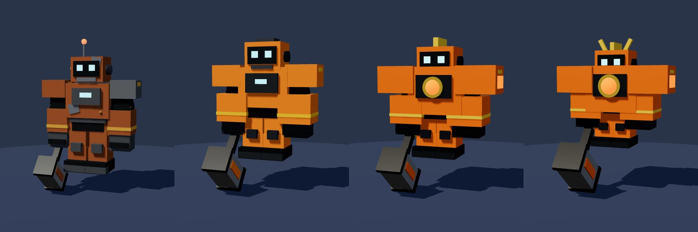
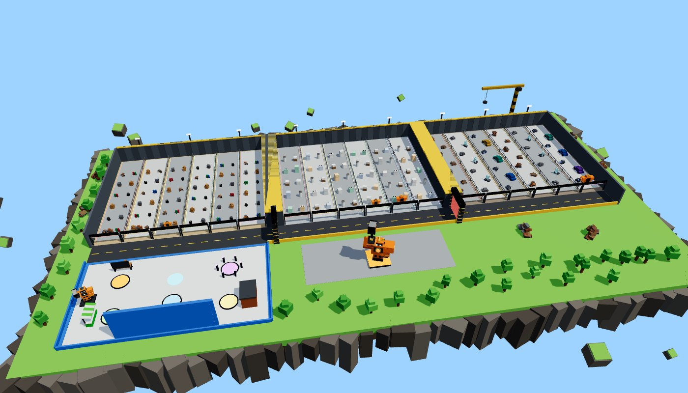
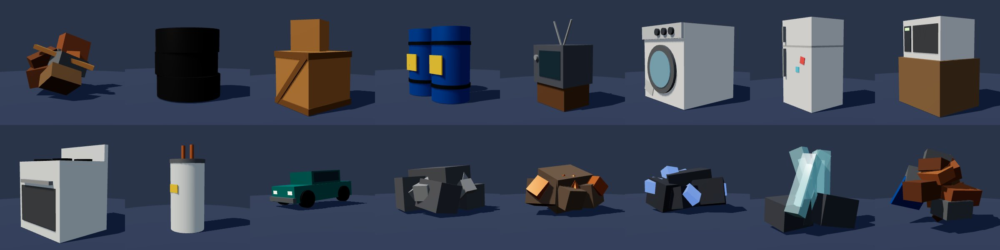
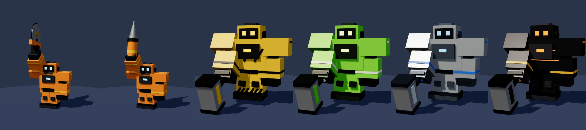

# Pick Your Mech!

**Start tiny. Smash junk. Build a giant.** A Roblox simulator built from the
*Pick Your Mech! — Complete Concept* (Oct 2026): pilot a small blocky robot, smash junk for
Scrap, buy Power, watch the mech grow from **Scrap Bot → Crusher → Mega Mech**, open new
yards, then rebirth for a permanent Scrap bonus.




*Renders above come from the game's own builder code run outside Roblox and drawn with
three.js. Roblox lighting (neon glow, shadows, sky) will look richer in Studio.*

## Open it

**Option A: just play.** Open `PickYourMech.rbxlx` in Roblox Studio and press **Play**.
The whole map, every model and all UI are built by scripts when the game starts.

**Option B: develop with Rojo** (live sync from this folder):
```bash
aftman install            # or: rokit install (installs rojo, selene, stylua)
rojo serve                # then connect with the Rojo plugin in Studio
rojo build -o PickYourMech.rbxlx   # rebuild the place file
```

### Before you publish
1. **Game Settings → Avatar:** R15 (the mech is built on the R15 rig).
2. **Game Settings → Basic:** Max players **6** (one lane per player).
3. **Game Settings → Security:** turn on *Enable Studio Access to API Services* to test saving in Studio.
4. **Monetization:** create the 5 passes and 2 developer products, then paste their IDs into
   `Config.Offers` in `src/shared/Config.luau`. Until then, Studio grants them for free so you
   can test every flow (`Config.StudioTestPurchases`).
5. Optional: badge IDs in `Config.Badges`, nicer sounds in `Config.Sounds`, and
   `Lighting.Technology = Future` in Studio.

## What's in the game

| Concept | Implementation |
|---|---|
| Auto-hit every 0.5 s for current Power, first hit after one interval | `CombatService` (server-owned) |
| Three yards, 6 lanes each, targets pay only their lane's owner | `Layout`, `LaneService`, `TargetService` |
| Starter Yard 10 HP / 4 Scrap · Appliance Row 100 / 40 · Crusher Yard 1,000 / 250 | `Config.Areas` |
| Gates: Power 10 + 100 Scrap, Power 250 + 1,000 Scrap | `ProgressService.unlockGate`, local barrier collision |
| 9 Power upgrades (5 → 15,000 Scrap) with visible milestones | `Config.Upgrades`, `MechBuilder` growth table |
| Scrap Bot → Crusher (lvl 4) → Mega Mech (lvl 7) on one shared rig | `MechBuilder` (same code for characters, statues and UI previews) |
| Hammer / Saw / Drill: free, identical stats | First-join picker + Garage |
| Rebirth: Power 1,000 + 20 Crusher smashes + fee 10k/20k/40k/80k/160k → +25% each | `ProgressService.rebirth` (two-tap confirm shows resets vs keeps) |
| Workshop 40 Scrap/h, cap 240, offline too · Daily contract 30 smashes → 100 + stamp, 5 stamps → finish | `ProgressService`, Rewards panel |
| Seven offers: Lime Paint 9, Worker Starter 19, Scrap Boost 19, 600 Scrap 29, Double Scrap 49, Auto Farm 79, Foundry VIP 99 | `ShopService` (passes re-checked each join; receipts granted once per PurchaseId and saved before confirming) |
| Boost time only counts in the yards, outside blocking menus, never offline | `ShopService` boost clock |
| Session-locked saves, autosave, shutdown save | `DataService` |
| Funnel analytics: first smash, upgrade, gates, forms, rebirth | `Analytics` |

**Pacing check:** `tests/Economy.spec.luau` simulates a free player with the concept's
assumptions and lands on the concept's numbers exactly: **first Crusher form at 2.0 min, first
rebirth at 9.75 min** (2x pass + boost: 2.49 min).

## Style
UI follows popular simulators (chunky outlined buttons, gradients, cartoon fonts, R$ price
cards, "!" badges, hover/press bounce), themed for a scrapyard. Tokens, components and copy
rules: [`docs/DESIGN_SYSTEM.md`](docs/DESIGN_SYSTEM.md).




## Project layout
```
src/shared/        Config, Economy (pure rules), Layout, Theme, MechBuilder, Signal
src/server/        Main + Services (Data, State, Lane, Mech, Target, Combat, Progress, Shop, Net, Analytics)
           Builders/ WorldBuilder (map), TargetModels (junk, appliances, cars, ore)
src/client/        Main, Net, UI (UIKit, Hud, Panels, Toasts, Viewport, Screens/*), Controllers (Effects, AutoFarm, WorldUI, ChatTags, Sound)
tests/             Economy.spec.luau (rules + pacing simulation)
tools/luau-runner  tiny Luau runner for the tests (Rust + mlua)
```

## Checks
```bash
selene src tests                 # lint (needs `selene generate-roblox-std` once)
stylua --check src tests         # formatting
cargo run --release --manifest-path tools/luau-runner/Cargo.toml -- run tests/Economy.spec.luau
```

## Known limits
- Built and verified offline (lint, compile, economy tests, model renders, code review), not
  yet play-tested on a live Roblox server. First Studio session: watch the Output window.
- Hit/swing animations are procedural (no animation assets needed); swap in uploaded
  animations later if you like.
- Default sounds are Roblox built-ins; replace them in `Config.Sounds`.
- All prices, pacing and rewards are the concept's test proposals; tune them in `Config`.
